Practicum Mooie kleuren en gradients:

Tijdens dit practicum heb ik geleerd hoe je met CSS kleuren en gradients kunt maken. We hebben gewerkt met RGB, HSL en verschillende soorten gradients.
In CodePen heb ik geoefend met kleurverlopen, patronen en het namaken van vormen met CSS.
Ik heb geleerd hoe je met alleen CSS verschillende kleuren en effecten kunt maken.

  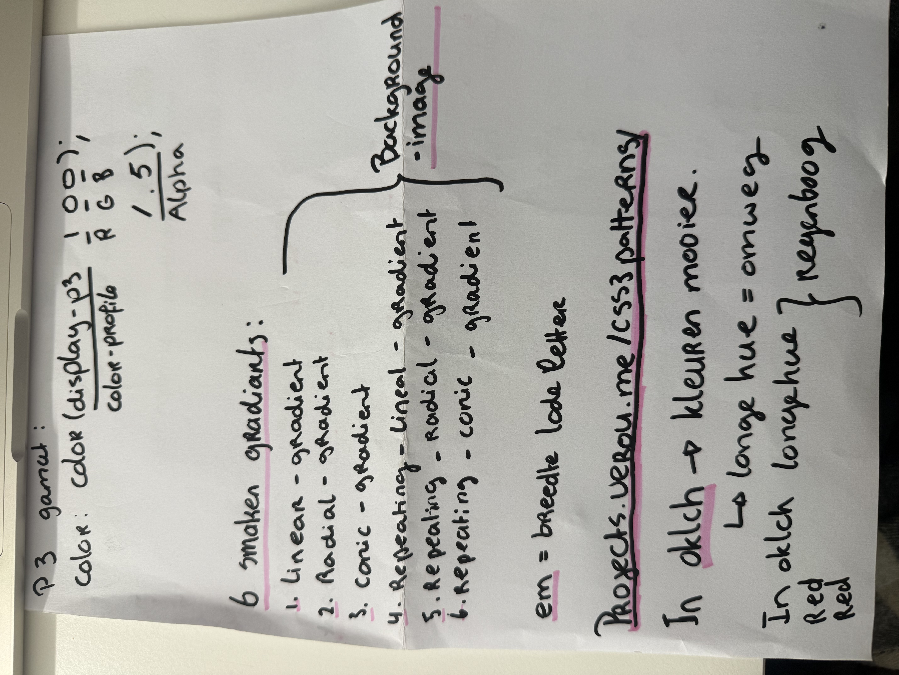
  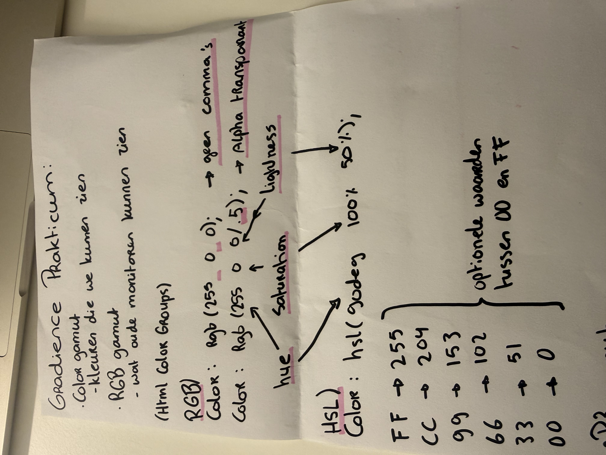
  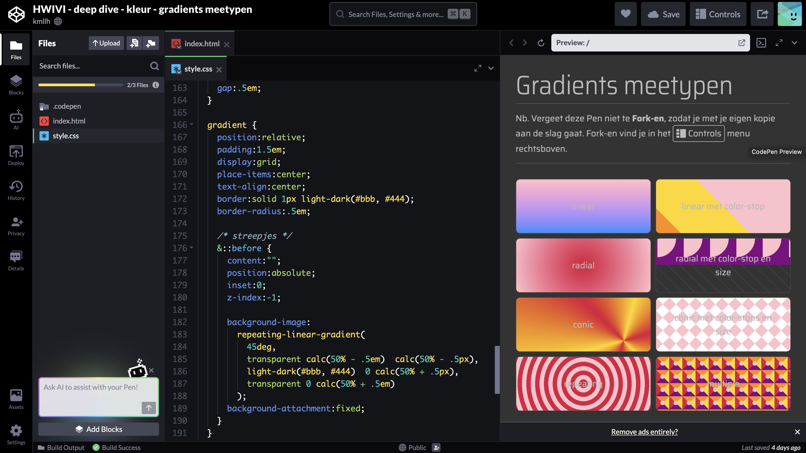
  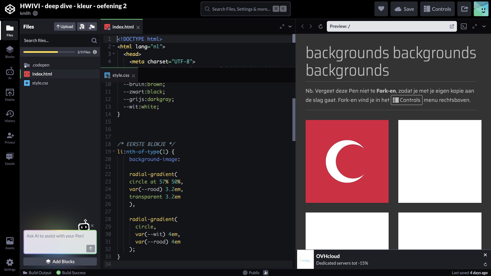

Practicum Light & Dark theme:

Tijdens deze les heb ik geleerd hoe je met CSS een licht en donker thema kunt maken voor een website. We hebben hiervoor verschillende oefeningen gedaan in CodePen.

Oefening 1 – Light & Dark:
Bij deze oefening heb ik gewerkt met CSS custom properties. Hiermee kun je kleuren instellen en hergebruiken. Ik heb geleerd hoe je met `light-dark()` verschillende kleuren kunt gebruiken voor een licht en donker thema. Ook heb ik geëxperimenteerd met kleuren en gradients.

Oefening 2 – Twee thema's:
Bij deze oefening heb ik twee verschillende thema's gemaakt. Met de knoppen kun je wisselen tussen een licht en donker thema.
Ik heb verschillende kleuren uitgeprobeerd om te zien hoe de website verandert.

  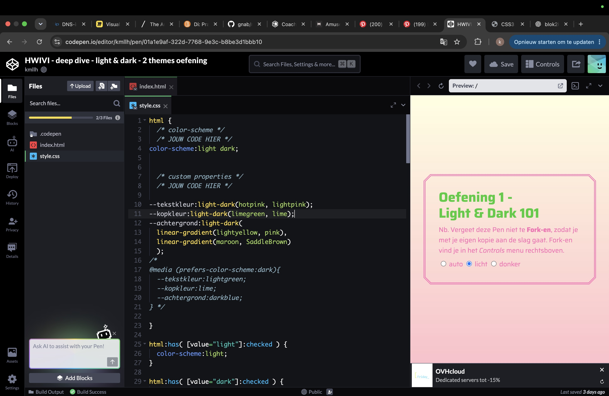
  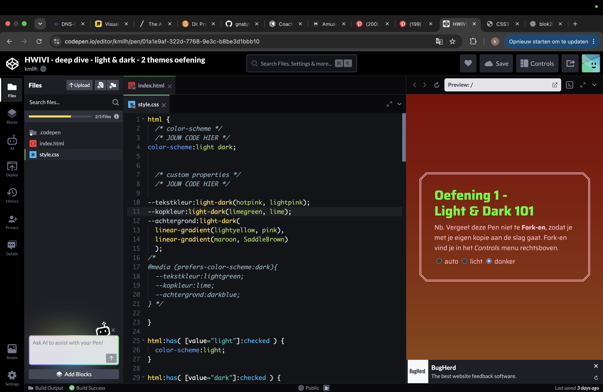

light & Dark iconen:
Bij deze oefening heb ik gewerkt met SVG-iconen. Ik heb geleerd dat je de kleur van een icoon met CSS kunt aanpassen, zodat het bij het lichte of donkere thema past.

  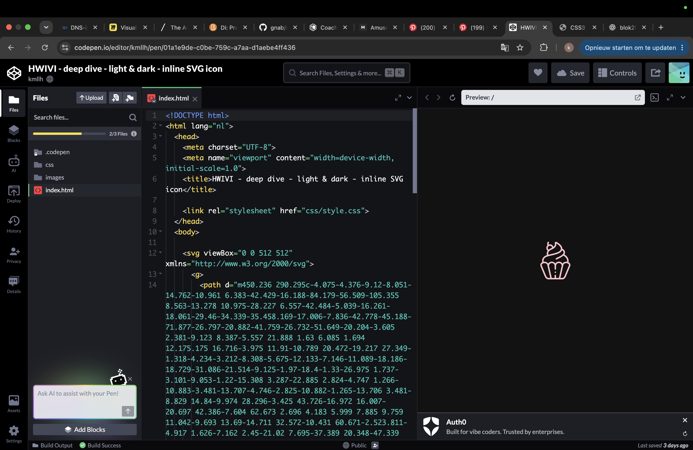

Wat heb ik geleerd?

- Hoe CSS custom properties werken.
- Hoe je met `light-dark()` kleuren kunt veranderen.
- Hoe je tussen een licht en donker thema kunt wisselen.
- Hoe je SVG-iconen kunt aanpassen met CSS.

Ik vond het interessant om te zien hoeveel verschil kleuren kunnen maken in het uiterlijk van een website.

lesdag 4:
Mijn onderwerp
Voor mijn Digital Garden wil ik een website maken over Sanrio, vooral Hello Kitty. Ik ben al sinds kleins af aan fan en wil mijn interesse delen door informatie, afbeeldingen en interactieve onderdelen te gebruiken.

Wat heb ik geleerd van de websites?

1. Anne Cook: Deze website vond ik vrij simpel en statisch. Alles werkt en is overzichtelijk, maar er is weinig interactie. Daardoor vind ik de website niet heel webby.

2. Meloland: Deze website vond ik interessanter door de animaties en interactieve elementen. Je kunt veel ontdekken door te klikken en te scrollen. Soms is de website wel onduidelijk en zijn de knoppen te klein.

  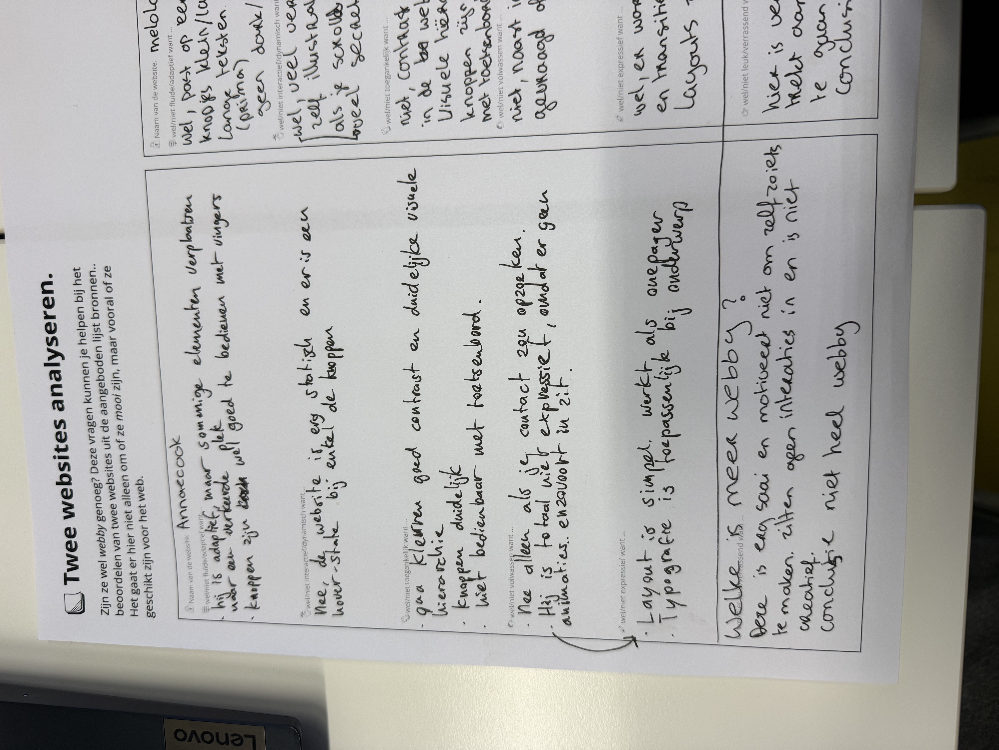
  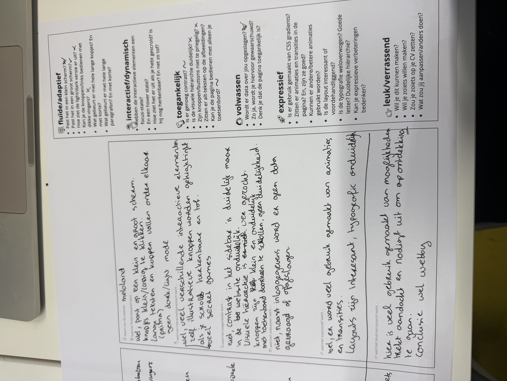

Wat wil ik zelf maken?
Ik wil een schattige, speelse website maken met:

- Verschillende Sanrio-personages en informatie.
- Roze pastelkleuren, ronde vormen en speelse letters.
- Afbeeldingen, hartjes en sterretjes.
- Klikbare onderdelen, hover-effecten en kleine animaties.

Welke webby elementen wil ik gebruiken?
Ik wil vooral inspiratie halen uit Meloland. Bijvoorbeeld door personages te laten bewegen als je er met je muis overheen gaat of door extra informatie te tonen wanneer je erop klikt. Wel wil ik mijn website duidelijk en overzichtelijk houden.

Ik wil zelf teksten schrijven over mijn favoriete Sanrio-personages en waarom ik al zo lang fan ben. Voor afbeeldingen wil ik bestaande Sanrio-afbeeldingen als inspiratie gebruiken. Ik wil een persoonlijke en nostalgische website maken waar bezoekers zelf dingen kunnen ontdekken. Tijdens dit project wil ik leren hoe ik met HTML, CSS en eventueel JavaScript een interactieve website kan bouwen.

sprint1
lesdag 3:
Vandaag heb ik verder geoefend met HTML en CSS. Ik heb geleerd hoe je een webpagina beter leesbaar en overzichtelijk maakt door lettertypes, witruimte en kleuren aan te passen.
Ook heb ik geleerd wat web-safe fonts zijn en hoe je met fontface zelf lettertypes kunt toevoegen aan een website.

Daarna heb ik verschillende oefeningen gemaakt waarbij ik teksten en blokjes moest namaken met CSS. Ik heb geoefend met lettergroottes, kleuren en effecten. Ook heb ik mini-posters nagemaakt en geleerd hoe je met hover en transition ervoor zorgt dat blokjes veranderen als je er met je muis overheen gaat.

Verder heb ik geleerd hoe je met CSS-variabelen zorgt dat je website overal dezelfde stijl heeft.

Sommige onderdelen vond ik nog lastig, vooral het werken met verschillende CSS-properties, maar door de oefeningen begrijp ik steeds beter hoe je een website kunt vormgeven.

lesdag 2:
Vandaag heb ik geleerd hoe je schetsen maakt voor een website of app. We begonnen met het oefenen van rechte lijnen, vierkanten en telefoonvormen. Daarna heb ik Instagram nagetekend en gekeken hoe het menu werkt als je erop klikt.

Ik heb geleerd hoe je met pijlen, kleuren en stippellijnen interacties kunt laten zien. Ook heb ik geleerd dat een schets niet perfect hoeft te zijn, zolang je idee maar duidelijk is.

Hieronder staan de schetsen die ik tijdens de les heb gemaakt.

  
  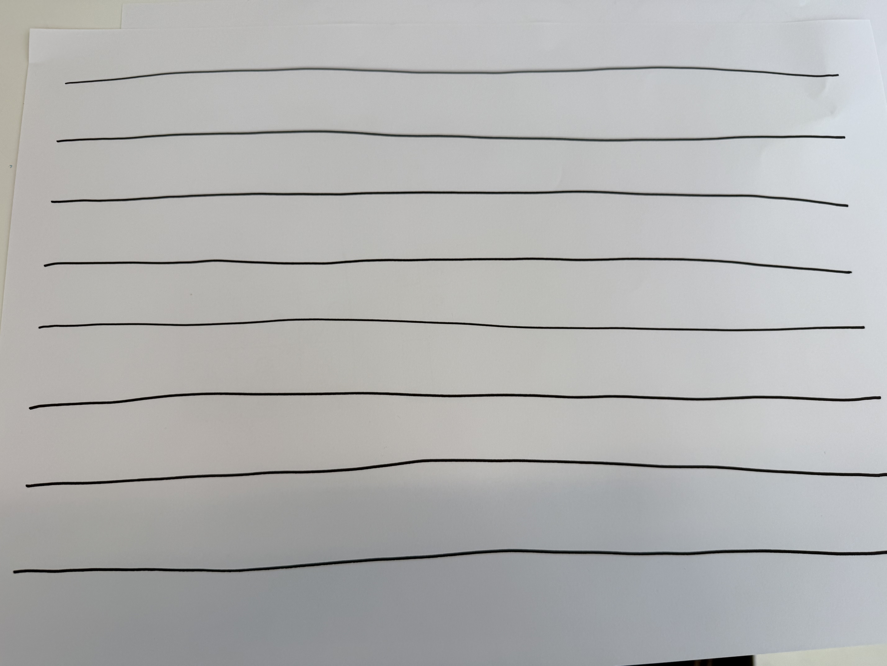
  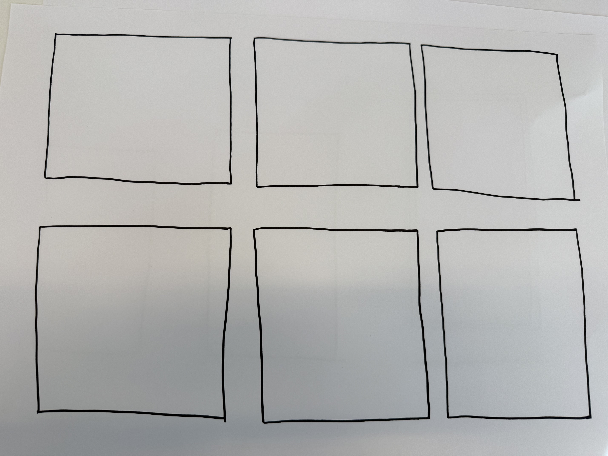

  
  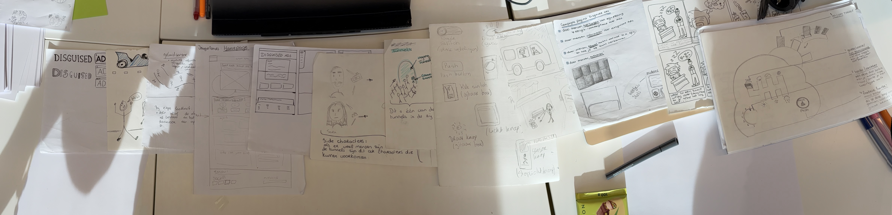

lesdag 1:
Ik heb vandaag geleerd dat een source hosting platform een website is waar je de bestanden en code van je eigen website kunt opslaan en beheren. Je kunt er ook wijzigingen aanbrengen.
Ik heb gekozen voor GitHub, omdat ik hier eerder mee heb gewerkt.

Ik heb gekozen voor de domeinnaam kenzaamallah.nl, omdat dit mijn eigen naam is. Om mijn domeinnaam aan mijn website te koppelen, gebruik ik GitHub Pages. Hierbij moet ik mijn domeinnaam instellen bij GitHub en de DNS-instellingen van mijn domein aanpassen, zodat bezoekers via kenzaamallah.nl op mijn website terechtkomen.

Ik kan mijn website aanpassen door de bestanden in mijn GitHub-repository te bewerken. GitHub Pages kan deze wijzigingen vervolgens automatisch publiceren, zodat ze zichtbaar worden op mijn website.

Ik heb dit nog nooit eerder gedaan, dus alle basisstappen die ik vandaag heb geleerd, waren helemaal nieuw voor mij. Het was soms even zoeken hoe alles werkt, maar ik heb vandaag veel nieuwe dingen geleerd over GitHub en het maken van een eigen website met behulp van mijn docent en klasgenoten.
