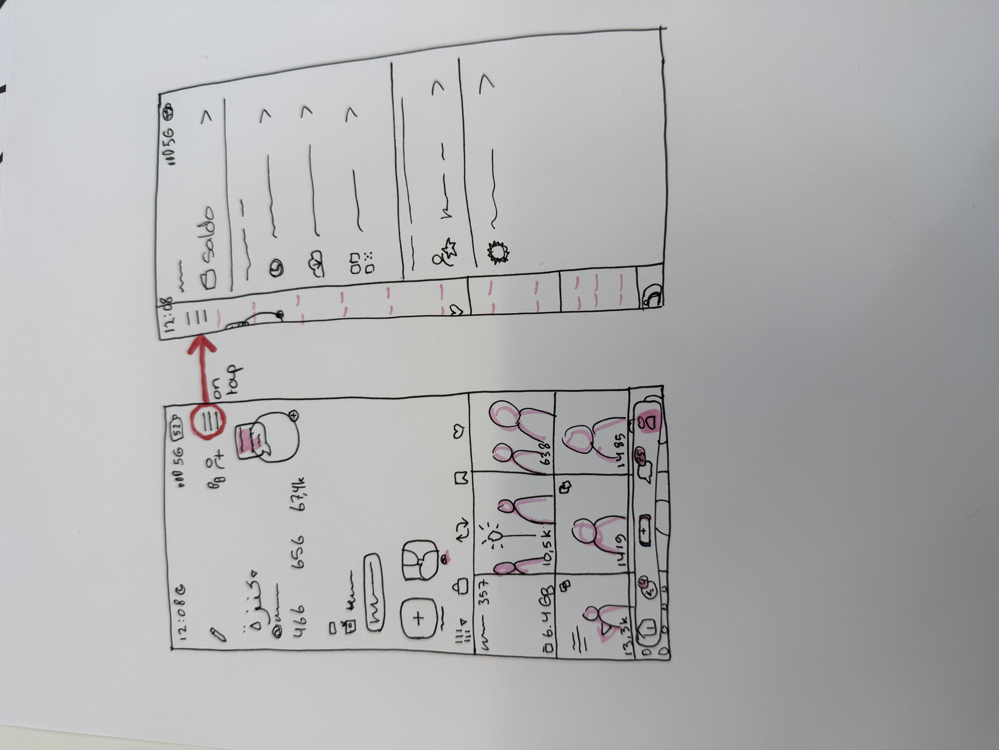
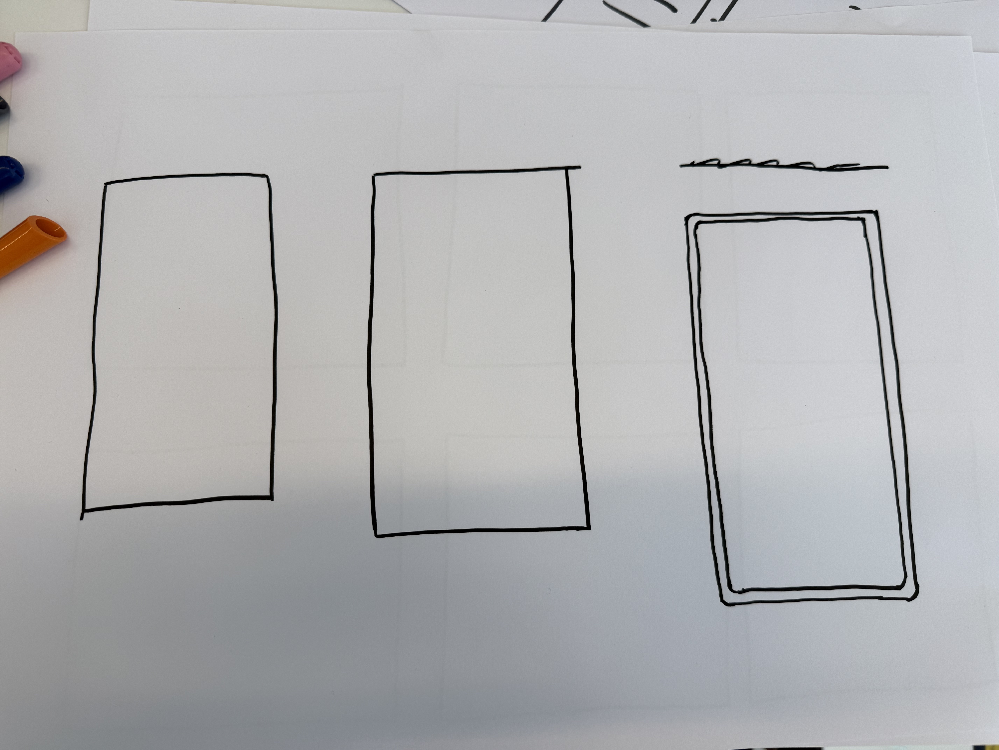

lesdag 2:
Vandaag heb ik geleerd hoe je schetsen maakt voor een website of app. We begonnen met het oefenen van rechte lijnen, vierkanten en telefoonvormen. Daarna heb ik Instagram nagetekend en gekeken hoe het menu werkt als je erop klikt.

Ik heb geleerd hoe je met pijlen, kleuren en stippellijnen interacties kunt laten zien. Ook heb ik geleerd dat een schets niet perfect hoeft te zijn, zolang je idee maar duidelijk is.

Hieronder staan de schetsen die ik tijdens de les heb gemaakt.

  
  
  

  
  

lesdag 1:
Ik heb vandaag geleerd dat een source hosting platform een website is waar je de bestanden en code van je eigen website kunt opslaan en beheren. Je kunt er ook wijzigingen aanbrengen.
Ik heb gekozen voor GitHub, omdat ik hier eerder mee heb gewerkt.

Ik heb gekozen voor de domeinnaam kenzaamallah.nl, omdat dit mijn eigen naam is. Om mijn domeinnaam aan mijn website te koppelen, gebruik ik GitHub Pages. Hierbij moet ik mijn domeinnaam instellen bij GitHub en de DNS-instellingen van mijn domein aanpassen, zodat bezoekers via kenzaamallah.nl op mijn website terechtkomen.

Ik kan mijn website aanpassen door de bestanden in mijn GitHub-repository te bewerken. GitHub Pages kan deze wijzigingen vervolgens automatisch publiceren, zodat ze zichtbaar worden op mijn website.

Ik heb dit nog nooit eerder gedaan, dus alle basisstappen die ik vandaag heb geleerd, waren helemaal nieuw voor mij. Het was soms even zoeken hoe alles werkt, maar ik heb vandaag veel nieuwe dingen geleerd over GitHub en het maken van een eigen website met behulp van mijn docent en klasgenoten.
